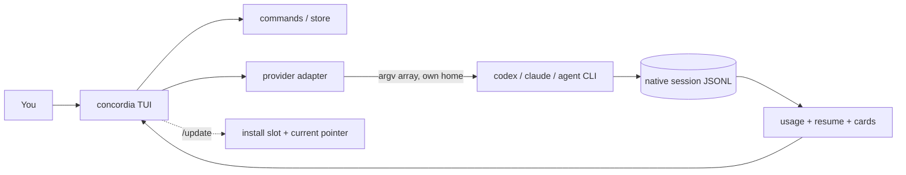

<h1 align="center">Concordia</h1>

<p align="center">
  <b>One terminal for all your AI coding subscriptions.</b><br>
  A fast, local, Rust TUI that drives Codex, Claude and Cursor under the accounts you already pay for.
</p>

<p align="center">
  
  
  
  
  
</p>

> **Status: pre-release, private.** Codex chat works end to end for an already-logged-in home.
> Account onboarding, Claude/Cursor parity and failover are in progress.
> The honest, ranked gap list lives in [docs/e2e-status.md](docs/e2e-status.md).

---

## Preview

A real render of the interface (this text is produced by the project's own screen tests):

```text
 ◆ concordia 2026-10-15s   Codex 3  gpt-5.1-codex                       5h 41% · 7d 59% · resets 3h
 · Type a message and press Enter. Start with / for commands. Drag to select; Ctrl+C copies; Esc
   interrupts.

 ❯ Add a /doctor check for duplicate accounts and show me the diff
   │ ✓ shell  rg -n duplicate src
   │ ✓ edit  src/doctor.rs
   │ ◉ shell  cargo test -p concordia
 ● What I changed

   I added a duplicate check to doctor. It groups accounts by provider and email, so two slots
   signed in to the same login are reported once.

   • accounts::duplicate_groups finds the groups
   • doctor prints a warning per group, naming both accounts and the fix
   • the /use picker marks each side with same login as ...

     rust
     for group in duplicate_groups(root) {
         warn(&group);
     }

   1. Run /doctor to see it
   2. Use /use remove to drop one


 ❯ looks good, thanks
 · provider exited with code 1


╭ message ─────────────────────────────────────────────────────────────────────────────────────────╮
│❯ Message Concordia…  (/ for commands)                                                            │
╰──────────────────────────────────────────────────────────────────────────────────────────────────╯
 Enter send · / commands · drag to select · Ctrl+C copy or cancel                    auth workspace
```

## Why Concordia

You pay for more than one AI coding tool. Each has its own CLI, its own login, its own session store and its own usage limit, and switching between them means losing your place.

`concordia` is a thin layer on top of the CLIs you already have. It does not replace them, proxy them, or touch your credentials.

- **Bring your own subscription.** No hosted service, no API keys, no extra billing. Concordia spawns the provider CLI under *your* login.
- **Switch accounts in one keystroke.** `/use` picks a provider and account; each account keeps an isolated home.
- **Robust turns.** Provider output with invalid UTF-8 or multi-megabyte lines cannot truncate a reply or exhaust memory; multi-line and special-character prompts are delivered over stdin when the provider CLI sits behind a Windows `.cmd` shim (which would otherwise reject or rewrite them); `Ctrl+C` kills the provider's whole process tree, not just its shim; a failing provider reports its exit code and stderr instead of an empty reply.
- **Safe shared state.** State writes are atomic, serialized across panes, and an unreadable `store.json` is backed up rather than overwritten; `concordia --version` and `concordia doctor` never modify anything.
- **Your credentials stay yours.** New accounts get an isolated home that Concordia creates; Concordia never reads, copies or asks for a password or key, and never writes to your existing `.codex` / `.claude` homes. Login is the provider's own flow.
- **Never guess a session.** Resume is always bound to an explicit session id. Concordia will never run `resume --last` or pick "whichever pane is focused".
- **Small and fast.** A single ~1.6 MB native binary, no Node, no Docker, no resident model.
- **Honest about state.** Every build carries a stamp so you can tell at a glance whether a pane is running stale code.

## Features

| | |
| --- | --- |
| Chat TUI | Streaming turns with live command and tool cards, built on `ratatui` |
| Mouse-native | Click to place the caret, drag to select, double/triple-click for word/line, wheel to scroll, right-click to copy or paste |
| Real prompt editor | Multi-line, caret and selection, word moves, cut/copy/paste, bracketed paste (pasted newlines never send) |
| Account picker | `/use` across Codex, Claude and Cursor homes |
| WezTerm launcher | `concordia wezterm` opens WezTerm running Concordia with split/tab keys (Ctrl+Shift+D/E/T); the config ships inside the binary |
| Slash palette | Type `/` for a live list of commands with descriptions; arrows and Tab to pick |
| Account connect | `/use add` creates an isolated home for a new account and opens the provider's own login; Concordia tells you when it connects |
| Usage at a glance | `/usage` reads limits from on-disk session data. No model call, no token spend |
| Explicit resume | `/resume` lists sessions and binds by id |
| Continuity pack | Bounded context hand-off when you switch provider mid-task |
| Trust modes | `ask`, `workspace`, `full`, shown live in the status line |
| Self-update | `/update` rebuilds, swaps to an unlocked binary slot, and re-execs in the same pane |
| Cancel | `Ctrl+C` terminates the tracked provider child process, nothing else |

## Install

**Requirements:** Windows 10/11, [Rust](https://rustup.rs) with MSVC Build Tools, and at least one provider CLI (`codex`, `claude` or `agent`) already logged in.

```powershell
git clone <this-repo> agent-orchestrator
cd agent-orchestrator
.\scripts\install-dev.ps1
```

The script builds a release binary, installs it to `%LOCALAPPDATA%\concordia\bin`, writes a `current` pointer so every launcher agrees on the active build, and prints the version.

```powershell
concordia --version
# concordia 0.0.1 (2026-10-15s)

concordia doctor      # health check: install, provider CLIs + versions, accounts; exit 1 on a problem
```

Run any copy of the exe once with `install` to put it on your PATH: `.\concordia-x86_64-pc-windows-msvc.exe install`, then open a new terminal.

Prebuilt downloads (`concordia-x86_64-pc-windows-msvc.exe`, `SHA256SUMS`, `THIRD-PARTY-LICENSES.txt`) will be attached to GitHub Releases once the project is published. Verify with `Get-FileHash .\concordia-x86_64-pc-windows-msvc.exe -Algorithm SHA256` against `SHA256SUMS`.

### Updating

`/update` adapts to how you installed Concordia:

- **From source:** inside the checkout it rebuilds, installs into a free slot, and restarts the pane on the new build.
- **From a release download:** it fetches the newest release of the configured repository (`CONCORDIA_UPDATE_REPO=owner/name`), verifies the checksum, confirms the new binary runs and reports the expected version, and only then switches over. If any check fails, nothing is installed. `/update check` shows what would happen without changing anything.

Concordia only contacts the network when you run `/update`.

## Quick start

```powershell
concordia
```

1. Type `/use` and pick an account.
2. Type a prompt and press `Enter`. `Ctrl+C` cancels.
3. Type `/usage` to see remaining limits, `/resume` to continue an earlier session.

### Commands

| Command | What it does |
| --- | --- |
| `/use` | Account picker (ends with `+ add account`) |
| `/use remove [account]` | Remove an account: delete what Concordia created, or just hide one of your own (your own login folders are never deleted) |
| `/use add [codex\|claude\|cursor]` | Connect a new account: isolated home under `%LOCALAPPDATA%\concordia\homes`, native login in a new window |
| `/model` | Models from on-disk caches only |
| `/usage` | Limits (Codex from cache; others shown as unknown if not exposed) |
| `/resume`, `/chats` | Pick an explicit session id (never `--last`) |
| `/trust` | `ask`, `workspace` or `full` |
| `/config` | Connection help, including manual login commands |
| `/new` | Clear the session bind |
| `/split` | Open another `concordia` in a WezTerm split |
| `/update` | Update (rebuild from source, or download the newest release), then re-exec this pane |
| `/update check` | Report whether an update is available, without installing |
| `/version` | Build stamp and paths |
| `/copy` | Copy the last assistant reply |
| `/doctor` | Quick health check (install, state, provider CLIs, accounts) |
| `/exit` | Quit |

### Keys

| Key / mouse | Action |
| --- | --- |
| `Enter` | Send turn |
| `Shift+Enter`, `Alt+Enter`, `Ctrl+J` | Newline without sending |
| `Tab` | Complete slash command |
| Click | Place the caret (prompt) |
| Drag, double-click, triple-click | Select text / a word / a line (prompt or transcript) |
| `Ctrl+C` | Copy the selection; with nothing selected, cancel the running turn; when idle, press twice to exit |
| `Up` / `Down` | Walk previously sent prompts (on the first / last prompt row); history is in memory only |
| `Esc` | Clear a selection, or interrupt a running turn. It never quits |
| `Ctrl+Shift+C`, `/copy` | Copy the last reply when nothing is selected |
| `Ctrl+A` / `Ctrl+X` / `Ctrl+V` | Select all / cut / paste in the prompt |
| Right-click | Copy the selection, or paste when there is none |
| Wheel, `PgUp` / `PgDn` | Scroll the transcript (sending a message snaps back to the latest) |
| `Shift` / `Ctrl` + arrows, `Home`, `End` | Extend selection, move by word, jump to line edge |

> **WezTerm note:** Concordia captures the mouse, so plain drags select inside Concordia. Hold `Shift` while dragging to use WezTerm's own selection instead. WezTerm intercepts `Ctrl+Shift+C`, so use `Ctrl+C`, right-click or `/copy`.

## Configuration

| Variable | Purpose |
| --- | --- |
| `CONCORDIA_STATE_DIR` | Where Concordia keeps its state (default `%LOCALAPPDATA%\concordia`) |
| `CONCORDIA_CODEX_BIN`, `CONCORDIA_CLAUDE_BIN`, `CONCORDIA_AGENT_BIN` | Use a specific provider CLI instead of the one on `PATH` |
| `CONCORDIA_EXE` | The active Concordia binary (set by the installer; follows the `current` pointer) |
| `CONCORDIA_INSTALL_DIR` | Install somewhere else (portable installs); also keeps tests off your real install |
| `CONCORDIA_UPDATE_REPO` | `owner/name` of the GitHub repository `/update` downloads releases from |
| `CONCORDIA_UPDATE_PRERELEASE` | `1` to include pre-releases (0.x installs include them automatically) |
| `CONCORDIA_UPDATE_API` | Alternate API base (a mirror); plain `http` is accepted only for loopback |

## How it works



- **Provider adapters** spawn the official CLI with a safe argument array and an isolated per-account home, then parse its structured output into cards.
- **Native state stays native.** Usage, sessions and models are read from the files the CLIs already write.
- **One owner for recovery.** A turn has exactly one tracked child process; cancellation and recovery never replay uncertain tool actions.
- **`concordia` is always the newest build.** A Windows exe is locked while it runs, so installing moves the old `concordia.exe` aside and puts the new one in its place; panes still running the old build keep working, and every new launch gets the new one. `%LOCALAPPDATA%\concordia\bin\current` names the active build for the WezTerm config and the npm shim.

More detail: [continuity](docs/continuity.md), [UI architecture](docs/ui-architecture.md), [provider capabilities](docs/capabilities.md), [provider terms](docs/provider-terms.md), [changelog](CHANGELOG.md).

## Project stats

Measured from this checkout, not estimated.

| Metric | Value |
| --- | --- |
| Rust source | 37 files, ~12.5k lines |
| Tests | 275 passing (unit, TUI end-to-end with simulated mouse/keys, a fake provider driving the real turn runner, continuity, control-plane) |
| Release binary | ~1.9 MB |
| Runtime dependencies | 11 direct, 71 crates total (all permissive except one unmodified MPL-2.0 crate; see `NOTICE`) (`ratatui`, `crossterm`, `tokio`, `serde`, `serde_json`, `anyhow`, `thiserror`, `uuid`, `dirs`, `which`, `unicode-width`) |
| Provider adapters | Codex, Claude, Cursor |

## Upgrading from `orc`

Concordia was called `orc` before 0.0.1 was tagged. Run `concordia install` once: it installs the
new binary, removes the old `%LOCALAPPDATA%\orc\bin` from your PATH (the files stay until you
delete them), and on first launch copies your old settings and registered accounts across. Open a
new terminal afterwards; panes started before the install keep running the old build.

## Roadmap

| Area | State |
| --- | --- |
| Launch / versioning (`current` pointer, build stamp, `/update`) | Done |
| Codex chat, cards, cancel, usage, resume | Working |
| Tab complete, paste, mouse selection, copy, scroll, caret editing | Implemented, awaiting live-pane verification |
| `/use add`: create and connect an account from inside Concordia | Implemented, awaiting live login check |
| Prompt history (up arrow), double-tap `Ctrl+C` exit | Done |
| Claude / Cursor session-id bind after turns | Planned |
| Exhaustion to another account with explicit session bind | Planned |
| Linux / macOS | Not claimed |
| Crew-style multi-agent delegation | Out of scope for v0.1 |

What stands between this and a public release is tracked in [docs/release-blockers.md](docs/release-blockers.md).

## Development

```powershell
cargo test -p concordia --tests
powershell -NoProfile -File .\scripts\smoke-e2e-everyday.ps1    # installs your build, then checks help, tests, usage read
powershell -NoProfile -File .\scripts\verify-oss-gates.ps1
```

Rules that keep this honest:

- Bump `BUILD_STAMP` in `crates/concordia/src/version.rs` on every user-facing change, so "still old" is falsifiable.
- `smoke-e2e-everyday.ps1` must exit 0 after every user-facing change.
- Live provider tests spend real subscription usage and need an explicit budget.
- Never overwrite a user's existing `.codex` / `.codex-2`; Concordia-owned homes live under Concordia's own state directory.

See [CONTRIBUTING.md](CONTRIBUTING.md) and [SECURITY.md](SECURITY.md).

## FAQ

**Does Concordia send my code or prompts anywhere?** No. It runs the provider CLI locally under your login. Concordia itself makes no network calls.

**Does it read my credentials?** No. Credentials stay in each provider's own home; Concordia never reads secret files.

**Does `/usage` cost tokens?** No. It reads limits from session data already on disk.

**Why not `resume --last`?** It resumes whatever was most recent, which is often the wrong conversation. Concordia only resumes an id you chose.

**My pane shows an old version.** The header stamp must match `concordia --version`. If not, that pane is stale: close it and open a new tab.

## License

[MIT](LICENSE). See [NOTICE](NOTICE) for third-party attributions.
