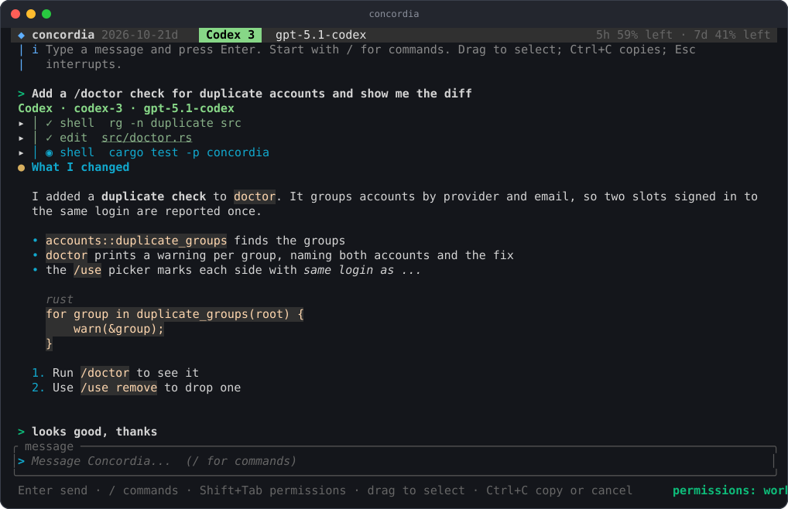
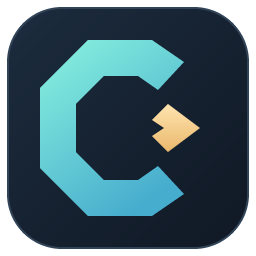
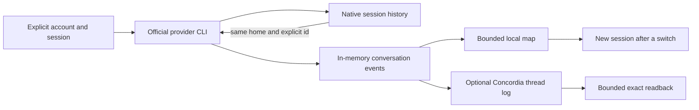
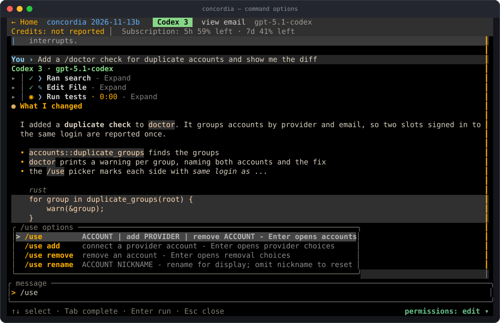
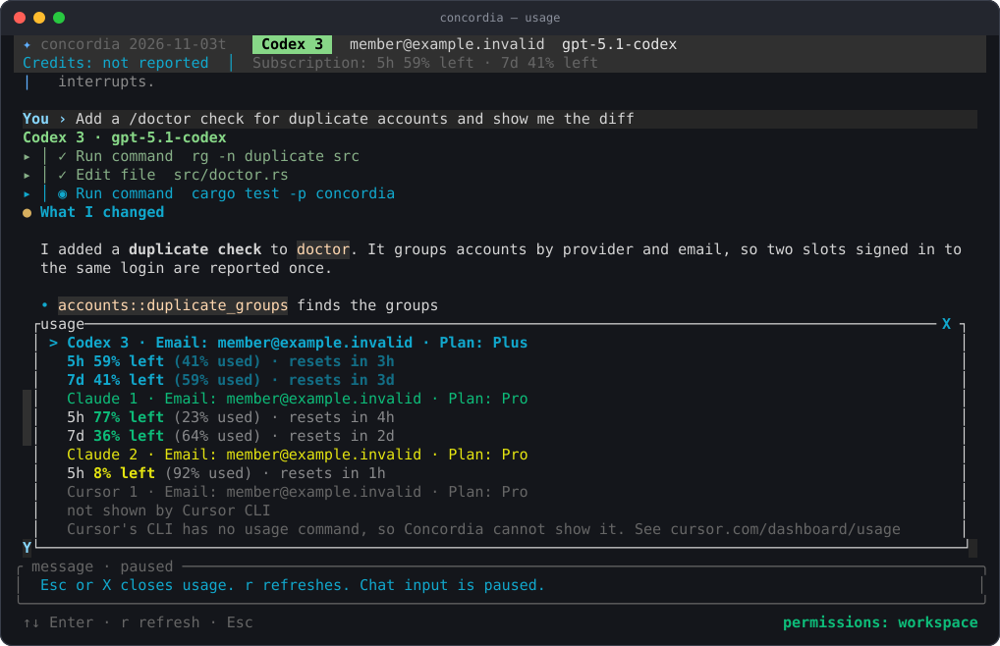
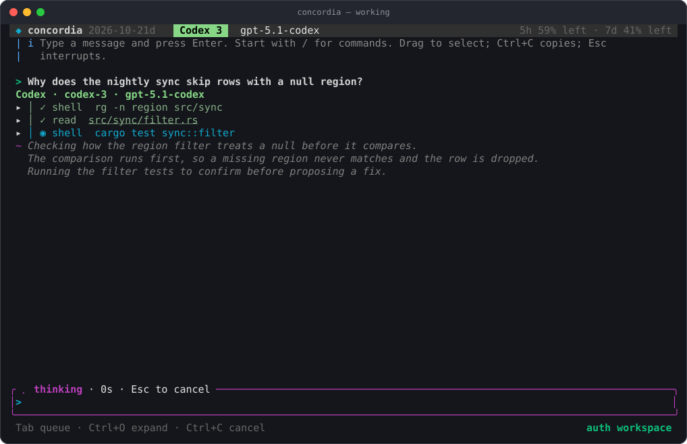
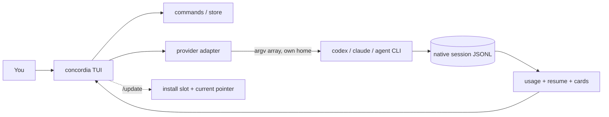

<p align="center">
  
</p>

<p align="center"></p>
<h1 align="center">Concordia</h1>

<p align="center">
  <b>Local memory management and orchestration for AI coding CLIs.</b><br>
  A native Rust app that connects tasks, accounts and sessions across Codex, Claude and Cursor.
</p>

<p align="center">
  <a href="../../actions/workflows/ci.yml"></a>
  
  
  
  
</p>

> **Status: private pre-release, Windows first.** Session continuity, bounded context maps,
> explicit workers, recent Codex/Claude native-source pointers, unfinished-request recovery and
> opt-in limit handoff are implemented. Related-chat discovery and capability-gated native context
> controls are available; [native memory](docs/native-memory.md) describes the shipped bounds.
> Fake-provider checks establish local behavior; live provider parity and physical-host checks
> remain separate release gates. See [release blockers](docs/release-blockers.md).

## Why Concordia

A task can outlive one chat, one account's usage window or one coding provider. Concordia's
purpose is to keep that task navigable and coordinate the work across those boundaries.
Memory management and orchestration are the core product. The shared interface makes their state,
sources and controls visible.

On Windows, `concordia` opens its own window. Ctrl+V, Ctrl+Shift+V and image-file drops reach the
application directly, without terminal-keybinding setup. `concordia --terminal` keeps the terminal
interface for explicit pane workflows; `concordia wezterm` keeps its terminal panes.

Concordia runs the official Codex, Claude Code and Cursor CLIs under your own accounts. Those
CLIs still execute model turns and tools, enforce their permission modes, and own authentication
and native session history. Concordia owns account/session binding, continuity between sessions,
worker coordination, queueing and recovery. It has no routing model, embedding service or hosted
memory backend.

## How memory works today

Concordia currently provides continuity with a small deterministic map. This is the foundation
for the planned memory manager, rather than a complete cross-provider retrieval system.

1. A normal turn uses an explicit provider, account home, model and native session id.
2. Continuing on the same provider and home resumes that native session by id. No context pack
   is added, and Concordia does not choose a session with `resume --last`.
3. Switching provider or account starts a new native session. The next prompt includes a map of
   the conversation's requests, touched files, commands, errors and last reply, capped at 1,600
   characters. The map is computed locally without a summarization call.
4. With optional thread logging enabled, the map points to `concordia thread read <id>`.
   `--grep`, `--tail` and `--range` retrieve a bounded exact excerpt. Without that log, the map
   is built from in-memory events and explicitly says full text is not stored.
5. `@chat` references can bring another recorded thread's map into a prompt. Optional MCP tools
   expose local chat/thread reads and search. Access varies by provider format; it is not full
   automatic recall of every previous conversation.



Enable the existing optional log with `[threads] enabled = true` in local `config.toml`.
New records store metadata and verified native-source references; reads hydrate the original
message/tool bodies. Persistent prompt recall also uses native references. Legacy logs remain
readable, while drafts, queues and unfinished recovery preserve input separately. Native provider
compaction remains active. Recognized capacity errors support one fresh-session rollover;
proactive rollover requires an explicitly enabled, verified native capacity signal.
See [reference storage bounds](docs/native-memory.md) for unsupported or oversized source records.
See [continuity](docs/continuity.md) and [architecture](docs/architecture.md) for the current
formats, read limits and storage paths.

## How orchestration works today

The conversation you type into is the orchestrator. Up to three registered worker accounts can
run bounded tasks in separate native sessions. `/delegate` provides worker controls; completed
results stay visible until you explicitly include them in the main conversation. Results are
labelled untrusted data and capped before inclusion. Provider-native subagents are a separate
source of reports shown in `/agents`; displaying a report does not start another model turn.

Each conversation has one active executor. Drafts and queued work are preserved across
interruption. Cancellation targets the tracked provider process tree. Tool requests and completed
tool results remain distinct, so uncertain work can be reconciled before continuing.

Usage exhaustion and context capacity are different conditions. An explicit quota failure can
trigger opt-in handoff to an ordered list of your accounts. The default is manual. Each account
is tried once, with at most three automatic handoffs per request. The new session receives the
original request and bounded map, with instructions to inspect completed workspace changes.
An unsent draft, active modal/edit or uncertain tool completion can stop automatic handoff;
queued prompts remain paused for explicit resume. There is no quota-prediction model or hidden
probe turn. Explicit cached-model fallback preferences are supported. See [configuration](docs/config.md).

For example, with account ids taken from your `/use` choices:

```toml
[continuation]
mode = "automatic"
accounts = ["codex-2", "claude", "cursor"]
```

This is a user-configured continuation policy. Native tool and approval state stays with its
original account. See [delegation](docs/delegation.md) and [configuration](docs/config.md).

## The memory manager we are building

The target design indexes pointers into provider-owned session files, preserving exact sources
instead of maintaining another full conversation archive. A bounded map leads to selective reads
from those originals. Explicit handoff lineage, project/file identity and timestamps make related
work discoverable; lexical matches suggest relationships without inventing certainty.

| Area | Available now | Next implementation milestone |
| --- | --- | --- |
| Session continuity | Explicit native resume and bounded cross-account maps | Durable lineage across handoffs |
| Source readback | Optional Concordia logs; native reads where supported | Validated native-file pointers with stale/missing-source handling |
| Retrieval | Explicit thread reads, references and local tools | Related-chat lookup with source citations and bounded results |
| Context capacity | Provider-native compaction and one-attempt explicit capacity-error recovery | Verified proactive capacity signals and compaction policy |
| Account routing | Manual selection or ordered opt-in quota fallback | Persisted account/model fallback choices and eligibility reasons |
| Worker routing | Explicit tasks, bounded workers and result adoption | Task policy, ownership and recovery tied to durable run identities |

These are implementation milestones, not shipped capabilities. Existing logs and drafts must
survive any migration. No automatic deletion, hosted memory service, extra summarizer calls or
resident inference model is part of this design. The detailed contract and acceptance criteria
are in the [memory and orchestration plan](docs/context-handoff-plan.md) and [PLAN.md](PLAN.md).

## Data and execution boundaries

Prompts and context you choose to send reach the selected provider through its official CLI.
Concordia has no hosted relay or telemetry service. Its updater can download releases, and
provider CLIs make their own network connections.

Account display reads local provider state, including authentication metadata for email and plan.
Provider CLIs own sign-in, credential refresh and tool execution. Each account has an explicit
home; Concordia does not rotate credentials beneath a running turn. Provider homes, optional
conversation logs, prompt history and recovery files should be treated as sensitive local data.
Pasted secrets can appear in saved prompts or provider history.

Memory retrieval does not grant tool permission. Permission modes, project policy and provider
approval controls still apply. Cross-provider handoff carries selected conversation context,
not native approval state. Current security scope and remaining release work are documented in
[SECURITY.md](SECURITY.md), [provider terms](docs/provider-terms.md) and
[release blockers](docs/release-blockers.md).

## Features

| | |
| --- | --- |
| Chat TUI | Streaming turns with live command and tool cards, built on `ratatui` |
| Mouse-native | Click to place the caret, drag to select, double/triple-click for word/line, wheel to scroll, right-click to copy or paste |
| Real prompt editor | Multi-line, caret and selection, word moves, cut/copy/paste, bracketed paste (pasted newlines never send) |
| Draft switching and latest output | Down at the last prompt row opens a fresh buffer; Up at its first row returns to the previous draft. Click `Bottom` at the top center of the prompt box to follow the newest output |
| Landing goals | Keyboard and mouse scrolling, visible goal entry in narrow windows, and saves that preserve additions and completed goals from other panes |
| Account picker | `/use` across Codex, Claude and Cursor homes |
| WezTerm launcher | `concordia wezterm` opens WezTerm running Concordia with split/tab keys (Ctrl+Shift+D/E/T); the config ships inside the binary |
| Slash palette | Type `/` to find commands; complete `/use`, `/model` or another family to reveal its actions and arguments |
| Account connect | `/use add` creates an isolated home for a new account and opens the provider's own login; Concordia tells you when it connects |
| Usage at a glance | `/usage` shows used and left per limit window: Codex from its session data, Claude from its local `/usage`, Cursor from its usage screen. No prompt is ever sent to a model |
| Explicit resume | `/resume` lists sessions and binds by id |
| Continuity pack | Bounded map and revision-checked native-source pointers on handoff |
| Unfinished work | Original request/source identity survives restart without sending newer drafts |
| File preview | Current-chat suggestions, raw/formatted views, search, reload and changed-file indicator |
| Trust modes | `ask`, `workspace`, `full`, shown live in the status line |
| Self-update | `/update` previews the source/release changes; Enter builds or downloads, then re-execs in the same pane |
| Cancel | `Ctrl+C` terminates the tracked provider child process, nothing else |

## Screenshots

Rendered from the real UI code with synthetic data (no provider is run). Regenerate with the command under [Contributing](#contributing).

| | |
| --- | --- |
| <br>Type `/` for a live command palette | <br>`/usage`: used and left per account |
| <br>A turn in progress: phase, live thinking, running tool card | <br>Tool cards and a markdown reply |

## Speed

Measured on 11th Gen Intel(R) Core(TM) i7-1165G7 @ 2.80GHz, Windows 11, 2026-10-15, build 2026-10-15x.

| Metric | Value |
| --- | --- |
| Release binary size | 2838 KB |
| Cold start, `concordia --version` (median of 30 runs) | 26.2 ms |
| Cold start, `concordia --version` (p95 of 30 runs) | 35.7 ms |
| `draw_ui` frame, busy transcript, 110x32 (mean of 500 frames) | 147 us |
| `draw_ui` frame, busy transcript, 110x32 (p95 of 500 frames) | 274 us |

Reproduce with `powershell -NoProfile -File scripts\metrics.ps1`; details in [docs/metrics.md](docs/metrics.md).

## Install

**Requirements:** Windows 10/11 and a provider CLI (`codex`, `claude` or `agent`) with your account. Public binary installs need no Rust compiler, SDK, administrator access or signing account. Building from source requires [Rust](https://rustup.rs) and MSVC Build Tools.

Full guide: [docs/install.md](docs/install.md). The public one-command flow is prepared below; it becomes available after this private repository and its first release are published:

```powershell
irm https://github.com/dariodaddamio/concordia/raw/main/scripts/install.ps1 | iex
```

From source today:

```powershell
git clone <this-repo> concordia
cd concordia
.\scripts\install-dev.ps1
```

The script builds a release binary, installs it to `%LOCALAPPDATA%\concordia\bin`, writes a `current` pointer so every launcher agrees on the active build, and prints the version.

```powershell
concordia --version
concordia doctor      # health check: install, provider CLIs + versions, accounts; exit 1 on a problem
```

Run any copy of the exe once with `install` to put it on your PATH: `.\concordia-x86_64-pc-windows-msvc.exe install`, then open a new terminal.

Prebuilt downloads (`concordia-x86_64-pc-windows-msvc.exe`, `SHA256SUMS`, `THIRD-PARTY-LICENSES.txt`) will be attached to GitHub Releases once the project is published. Verify with `Get-FileHash .\concordia-x86_64-pc-windows-msvc.exe -Algorithm SHA256` against `SHA256SUMS`.

### Updating

`/update` adapts to how you installed Concordia:

- **From source:** it shows the installed build, the checkout's build, its branch and whether it has uncommitted files, and the incoming changelog entries. H expands earlier history. Enter rebuilds, installs into a free slot and restarts the pane on the new build; while it builds, the message box shows that sending waits for the restart.
- **From a release download:** `/update` opens a fresh page with the newest release and its notes from the built-in official release feed (forks can override `CONCORDIA_UPDATE_REPO=owner/name`). Enter fetches it, verifies the checksum, confirms the new binary runs and reports the expected version, and only then switches over. If any check fails, nothing is installed. Esc returns to your chat; `o` opens the release page.

Provider CLIs make their own network connections for turns, sign-in and usage views. Concordia
has no hosted relay or memory service; `/update` can download a release.

## Quick start

```powershell
concordia
```

1. Type `/use` and pick an account.
2. Type a prompt and press `Enter`. `Ctrl+C` cancels.
3. Type `/usage` to see remaining limits, `/resume` to continue an earlier session.

## Workflows

**You ran out of usage mid-task.** A provider-reported quota failure pauses the request.
Manual mode offers another account; opt-in automatic mode tries the configured account order.
The new native session receives the original request and a deterministic map capped at 1,600
characters, with pointers for additional readback when logging is enabled. Native tool and
approval state stays with the previous account. Uncertain tool completion stops automatic
handoff, and queued prompts remain paused until explicitly resumed. See the orchestration
section above for bounds and model-selection limitations.

**You continue the same conversation on the same account.** Nothing is injected. Concordia resumes the explicit session id it recorded (`--resume <id>`), never `--last`.

**You want an earlier chat back.** `/resume` binds the selected account/session and restores recent Codex/Claude messages as scrollback. PageUp and the mouse wheel let you review them before sending anything. Cursor history availability is shown explicitly. Titles are generated from the first request and saved independently of optional thread logging.

**You want to inspect subagents.** `Ctrl+G` opens reported native child-agent activity and Concordia worker jobs. Enter opens the task, state and reported result. Codex collaboration events and Claude Agent/Task cards are supported; available detail depends on what the provider emits.

**You think of the next prompt while a turn runs.** Press `Tab` to queue it; the queue shows above the prompt box and each item is sent when the turn before it finishes cleanly. `Ctrl+Up` focuses the queue while preserving your draft. Enter opens a multiline upper editor and saves it; Esc cancels the edit. `Ctrl+Down` returns to the draft after save/cancel; `Alt+Up/Down` reorders queued prompts. Cancelling, failure and restart pause the queue: `Ctrl+R` resumes it. Click **Send now**, press Ctrl+Enter or Alt+Enter on a focused queue row, or use `/queue send 2` to send that item after stopping the active turn; other queued items stay paused. Drafts and queues use separate recovery records for each pane and workspace. Sent history remains shared.

**You want help from another account.** Open `/delegate` to add a worker, then use `/delegate <account> <task>` as a shortcut. The worker runs one visible turn with its own session and a bounded slice of context. Its result comes back as a labelled block and can be sent to your main conversation from that screen ([delegation](docs/delegation.md)).

**Do the models know they are inside Concordia?** Not in general today. They see the pack header after a switch, and delegated workers get a labelled task. A short opt-in "you are running inside Concordia" note, `@chat` references that expand to a bounded pack, and a `/handoff` command are on the [roadmap](#roadmap).

## Commands

Harness adapters are available through `/harness help`: connect any user-owned manifest, verify a
real denial for locked-code policy, inspect declared tools with `/harness tools`, or run one by
name. Commands execute as argv without a shell and provider homes remain isolated.

| Command | What it does |
| --- | --- |
| `/use [ACCOUNT]` | Switch, add or remove accounts |
| `/model [MODEL]` | Choose a model from the active account's catalog |
| `/mode` | How much the agent may do without asking |
| `/usage` | Limits for every account (`r` refreshes, `t` shows tokens through Concordia) |
| `/new` | Start a fresh chat, opening on the landing page |
| `/resume` | Continue an earlier chat (`Delete` confirms removal) |
| `/delegate` | Run tasks on worker accounts; management choices are inside the screen |
| `/harness` | Connect and run harness tools |
| `/open` | Browse chat, recent and workspace files/folders; Enter opens, Esc or X leaves the browser |
| `/copy` | Copy the last reply |
| `/doctor` | Check your setup, version and configuration |
| `/update` | Preview an update; Enter builds/downloads an available update |

## Keyboard and mouse

| Key / mouse | Action |
| --- | --- |
| `Enter` | Send turn |
| `Shift+Enter`, `Alt+Enter`, `Ctrl+J` | Newline without sending |
| `Tab` | Complete a slash command; while a turn runs (or prompts are queued), queue the typed prompt |
| `Shift+Tab` | Cycle the mode: plan, ask, auto-edit, full (moves the selection up while the palette is open) |
| `Alt+Up` / `Alt+Down` | Select a worker row; `Enter` opens its transcript, `Esc` closes it. In the queue panel, move the selected prompt up or down |
| Click | Place the caret (prompt); release on an underlined file reference to open its internal split pane. Alt+click requests formatted preview; dragging keeps selection |
| Drag, double-click, triple-click | Select text / a word / a line (prompt or transcript) |
| `Ctrl+C` | Copy the selection; with nothing selected, cancel the running turn; when idle, press twice to exit |
| `Up` / `Down` | Walk previously sent prompts (on the first / last prompt row); with an empty box and a non-empty queue, `Up` focuses the queue panel (`Enter` edits, `Delete` removes, `Esc` returns). Recall uses `<state>\history.refs.jsonl`; legacy history remains readable (`[ui] persist_history`) |
| `Esc` | Clear a selection, or interrupt a running turn. It never quits |
| `Ctrl+Shift+C`, `/copy` | Copy the last reply when nothing is selected |
| `Ctrl+A` / `Ctrl+X` / `Ctrl+V` | Select all / cut / paste in the prompt |
| `Ctrl+O` | Expand or collapse full received tool activity and reasoning |
| `Ctrl+E` | Open searchable raw tool output; thinking expands inside chat. `Esc` closes and `Ctrl+C` copies |
| `Ctrl+Up` / `Ctrl+Down` | Focus queued prompts / return to the draft after save or cancel |
| `Ctrl+R` | Resume a paused queue while preserving the draft |
| `/open PATH` | Internal file pane; formatted Markdown/JSON by default, raw editable source with syntax colors. Alt+V switches view; Ctrl+S saves; F6 changes focus; Esc returns to chat; X closes with an unsaved-edit decision |
| `Ctrl+Backspace` | Delete the previous word in the prompt |
| `Ctrl+Z` | Undo in the prompt (also right after a send, which puts the sent text back) |
| `Ctrl+Shift+Z`, `Ctrl+Y` | Redo |
| Right-click | Copy the selection, or paste when there is none |
| Wheel, `PgUp` / `PgDn` | Scroll the transcript (sending a message snaps back to the latest) |
| `Shift` / `Ctrl` + arrows, `Home`, `End` | Extend selection, move by word, jump to line edge |

> **WezTerm note:** Concordia captures the mouse, so plain drags select inside Concordia. Hold `Shift` while dragging to use WezTerm's own selection instead. WezTerm intercepts `Ctrl+Shift+C`, so use `Ctrl+C`, right-click or `/copy`.

## Icons and animations

| Where / symbol | Meaning |
| --- | --- |
| Header `◆` | Concordia; pulses cyan/blue while a turn runs |
| Cyan rotating dots `⠋ ⠙ ⠹` | Awaiting the selected provider's first or next output |
| Magenta moving dot `⠁ ⠂ ⠄` | Provider reports thinking/reasoning |
| Yellow rotating dense dots `⣾ ⣽ ⣻` | A provider tool is running; its name appears beside the animation |
| Green moving dots `⠉ ⠙ ⠚` | Answer text is streaming |
| Tool `▸` / `▾` | Collapsed / expanded output; click to toggle; an expanded header pins while scrolling |
| Worker `◌` / `✓` / `✗` | Queued / finished / failed; live workers use the same phase animations as the main run |
| Transcript `>` / `●` / `~` | Your prompt / provider reply / reasoning |
| Notice `i` / `+` / `!` / `x` | Information / success / warning / error |
| Footer `full ⚠` | Full permission mode; native permission checks are bypassed where the provider supports it |
| Hand cursor | A clickable control or file reference, on terminals supporting cursor-shape feedback |

The adjacent timer measures the whole current turn, including tool time. Motion indicates the last
reported phase; it does not measure progress, token use, or provider-side activity during silence.
Green/yellow/red usage text indicates normal/low/depleted capacity; unknown values stay muted.

Terminal tabs use `◇` Idle, `◌` Waiting, `✦` Thinking, `⚙` Running tool, `✎` Writing,
`■` Stopping, `↻` Updating, or `!` Usage limit. The readable state remains beside the icon.
See the [UI glossary](docs/ui-glossary.md) for controls, file previews and chat references.

## Images and diagrams

Paste an image with Ctrl+V, use `/attach` to choose one, or `/attach PATH`. Preview chips support
open/remove; `/attach clear` removes draft images. Native image inputs are implemented for Codex,
Claude and Cursor (ACP capability/model support required). Snapshots stay with drafts, queues and
recovery. Mermaid fences render as local terminal diagrams in chat and formatted Markdown.
See [images and diagrams](docs/images-and-diagrams.md) for limits and transport evidence.

## Files beside chat and chat references

Click a local file link or path in the transcript, including `@src/main.rs`, to open its
split pane. `/open src/main.rs:42` or `/open @src/main.rs:42` opens it directly without a model call.
Repeat for up to three files; drag dividers to resize, use F6 to change focus, Esc to return to chat,
and X or `/close ID` to close. Press Alt+V in a focused file pane, or click its view bar, to switch
between raw text and formatted Markdown/JSON. `/preview FILE` starts in formatted mode when
supported; other file types retain raw text. Resize borders request horizontal/vertical resize
cursors, and clickable controls request a hand cursor through OSC 22 (terminal support required).
File preview does not attach the file contents to a provider prompt.
Raw mode supports internal editing and explicit Ctrl+S save; `/edit FILE` uses an external editor.

`/open` without a path browses files from the current chat, recently previewed files in this
workspace, and the workspace itself. The title shows the directory. Enter opens a file or folder;
type part of a name to filter. Generated, ignored and sensitive paths are excluded from discovery.
Recent files survive a new chat. Discovery is bounded, so an explicit path can open a file outside
the scanned set.

Relative paths resolve from Concordia's working directory: `/open docs/notes.md`.
Absolute paths also work: `/open "C:/work/project/notes with spaces.md"`. A `:42` suffix jumps to a
line. Typing `/open docs/` or `@docs/` offers matching paths; Tab completes, Enter opens a `/open`
result. For `@` results, Tab/Enter inserts the reference; Ctrl+P or clicking previews it while
keeping the draft. Recorded-chat references remain in the `@` menu. Side-by-side chat previews
remain planned; literal file references stay clickable in the transcript.


## Behaviours worth knowing

`/usage` shows each connected account's email and plan beside its account name, above its limits; providers that omit a field
show `not reported`. A workspace name is displayed separately from its subscription tier.
Use `/use add` to connect Codex, Claude or Cursor, and `/use remove` to choose an account to remove.
Finish typing `/use` or `/model` to reveal actions and argument hints immediately. Tab advances
into arguments; Up/Down selects a choice and Enter opens or applies it. Suggestions
use connected accounts and the active provider's on-disk model catalog. `/use ACCOUNT` switches
accounts; `/model MODEL` chooses an available model. The chat title stays in the terminal tab and
resume list; the main status header shows the active account and email, with model and limits as space permits.
Set a display nickname with `/use rename codex Work`; omit `Work` to reset it. Names persist locally
and appear in the header, account choices and worker strip. Commands and fallback configuration keep
using stable account IDs such as `codex` and `codex-2`; renaming never changes a login or provider home.


The elapsed timer beside the live run status omits unused leading units: `20s`, `8m 20s`,
or `1h 02m 03s`. The waiting label names the account and whether its first or next output is awaited. Expanded tool output pins its header at the top as you
scroll, so you can click it to collapse without finding the original line. Terminal titles use the
chat or project name with a status icon and a readable state such as Idle, Thinking or Writing.
Codex usage warnings say `updates after a Codex response`: the figures come from the provider's
latest saved response, rather than a live balance request.

Concordia opens on a landing page when this machine has recorded chats. The left pane lists recent
chats grouped by the folder they ran in, with this folder first. Enter resumes a chat, or expands a
folder; a double-click does the same. Older one- or two-turn chats are grouped into collapsed
`Quick questions` rows under their folder. Generated test, qualification, temporary and repository
`target` workspaces are hidden by default; press `h` or click the footer's `show N hidden` label to
reveal them. The right pane holds your goals: `Tab` to it, `a` adds one,
and Enter marks one done. An empty pane explains what goals are and how to add one. When a Harness is connected (`/harness connect harness`), the pane also
lists each project's open work from its plan ledger. Chats and goals stay visible while you type or
paste a draft; Enter sends it. Up/Down wrap between the first and last list entries when the draft
is empty. `Esc` goes straight to chat; `/new` opens the page again. The page shows all-time and rolling
24-hour token usage recorded through Concordia, including cached input. Older unrecorded usage is
not reconstructed. Copying with right-click or Ctrl+C keeps the selection highlighted. Clickable
rows, buttons and file links request a hand cursor on terminals supporting OSC 22.

Generated test, qualification, temporary and repository `target` workspaces are hidden by default;
press `h` to show all. Older one- or two-turn chats collapse into per-folder Quick questions rows.
Cached connected-account 5h and 7d usage meters, including reset times, appear beneath goals.


- **Continuing on the same account** resumes the session id Concordia recorded (`--resume <id>`). Nothing is added to your prompt.
- **Switching account or provider** starts a new session on the other side, with bounded recent context in front of your next prompt. Tool state, approvals and the provider's own memory are not carried over, and the pack says so in its header.
- **Limits come from three different places.** Codex's numbers come from its own session files, so they appear only after a chat and reflect the last one; a window that has reset since then shows as reset, not as still used. Claude's come from its own local `/usage`, which takes a few seconds. Cursor has no usage command, so Concordia reads Cursor's interactive usage screen in a hidden pseudo-console (in an empty temporary folder that Cursor is told to trust), about six seconds the first time. Claude and Cursor readings are cached, re-checked after every turn and whenever they are older than two minutes, and show their age once they are. When a provider gives nothing, the footer says why instead of showing a number.
- **`/usage` never sends a prompt to a model.** It runs each CLI's own usage view.
- **Streaming and thinking.** Claude and Cursor run in streaming mode, so tool and command cards appear as they happen. Reasoning is shown only if the provider emits it, as dim lines that stay in the transcript but are never sent as context.
- **Plan mode** maps to each CLI's own flag. Codex has no separate plan mode, so Plan there is the same read-only sandbox as Ask.
- **Concordia awareness is configurable.** Homes Concordia creates can receive a short awareness
  note; optional MCP registration exposes local tools. `@chat` and bounded maps are implemented.
  User-owned provider setup is preserved. See [architecture](docs/architecture.md).
- **Private pre-release.** The owner chose unsigned distribution. Public repository visibility, first release assets and an exact-artifact public install/update rehearsal remain pending; signing is not required. An earlier private artifact triggered Defender, so current exact-artifact antivirus validation remains required. See [Windows signing](docs/windows-signing.md) and [release blockers](docs/release-blockers.md).
- **Not yet verified live:** the `/use add` login window, mouse selection inside WezTerm, and real multi-line turns through each provider. The automated tests use a fake provider by design, so they never spend your subscription.

## Safety and provider terms

- Concordia runs the **unmodified** provider CLIs under **your own logins**. It is not a proxy and does not pool or share accounts.
- New accounts get isolated homes and sign in through the provider's own flow. Account display
  reads local provider metadata, including public email and plan claims. Treat those homes as
  sensitive; Concordia preserves user-owned provider configuration.
- The updater can fetch releases. Provider CLIs and explicitly invoked harness tools use their
  own connections; there is no hosted Concordia memory backend.
- What the providers' terms say, and where the lines are: [docs/provider-terms.md](docs/provider-terms.md).

## Configuration

| Variable | Purpose |
| --- | --- |
| `CONCORDIA_STATE_DIR` | Where Concordia keeps its state (default `%LOCALAPPDATA%\concordia`) |
| `CONCORDIA_CODEX_BIN`, `CONCORDIA_CLAUDE_BIN`, `CONCORDIA_AGENT_BIN` | Use a specific provider CLI instead of the one on `PATH` |
| `CONCORDIA_EXE` | The active Concordia binary (set by the installer; follows the `current` pointer) |
| `CONCORDIA_INSTALL_DIR` | Install somewhere else (portable installs); also keeps tests off your real install |
| `CONCORDIA_UPDATE_REPO` | `owner/name` of the GitHub repository `/update` downloads releases from |
| `CONCORDIA_UPDATE_PRERELEASE` | `1` to include pre-releases (0.x installs include them automatically) |
| `CONCORDIA_UPDATE_API` | Alternate API base (a mirror); plain `http` is accepted only for loopback |
| `CONCORDIA_CONFIG` | Path of `config.toml` (default `<state>\config.toml`) |

Optional defaults live in `config.toml`, and your own slash commands in `commands\*.md`, both under the
state directory: see [docs/config.md](docs/config.md).

## How it works



- **Provider adapters** spawn the official CLI with a safe argument array and an isolated per-account home, then parse its structured output into cards.
- **Native state stays native.** Usage, sessions and models are read from the files the CLIs already write.
- **One owner for recovery.** A turn has exactly one tracked child process; cancellation and recovery never replay uncertain tool actions.
- **`concordia` is always the newest build.** A Windows exe is locked while it runs, so installing moves the old `concordia.exe` aside and puts the new one in its place; panes still running the old build keep working, and every new launch gets the new one. `%LOCALAPPDATA%\concordia\bin\current` names the active build for the WezTerm config and the npm shim.

More detail: [continuity](docs/continuity.md), [UI architecture](docs/ui-architecture.md), [provider capabilities](docs/capabilities.md), [provider terms](docs/provider-terms.md), [changelog](CHANGELOG.md).

## Verification and release scope

The project remains a private pre-release. Source builds and local installation are supported;
public release assets must not be assumed to exist. Automated tests use synthetic
accounts and fake providers. They establish local transport, binding, UI and recovery behavior;
they do not certify every provider version, real login flow or physical terminal host.

The next product work is the native-source memory index and durable account/model orchestration
policy. Distribution work includes independent security review, provider compatibility evidence,
terms review, licensing/attribution checks and a reproducible release process. Track the concrete
criteria in [PLAN.md](PLAN.md), [release blockers](docs/release-blockers.md) and the
[evidence ledger](docs/e2e-status.md). Query `concordia --version` for the actual installed build.

## Contributing

Windows source builds require the Microsoft C++ toolchain and Windows SDK, including `rc.exe`
for the embedded application icon. Installed binaries do not require those build tools.

```powershell
cargo test -p concordia --tests
powershell -NoProfile -File .\scripts\smoke-e2e-everyday.ps1    # checks the installed build, help, tests and a read-only usage reader
powershell -NoProfile -File .\scripts\verify-oss-gates.ps1
cargo test -p concordia --lib screenshots -- --ignored            # regenerate docs/img/*.svg after a UI change
powershell -NoProfile -File .\scripts\metrics.ps1                # regenerate docs/metrics.md
```

Rules that keep this honest:

- Bump `BUILD_STAMP` in `crates/concordia/src/version.rs` on every user-facing change, so "still old" is falsifiable.
- `smoke-e2e-everyday.ps1` must exit 0 after every user-facing change.
- Live provider tests spend real subscription usage and need an explicit budget.
- Never overwrite a user's existing `.codex` / `.codex-2`; Concordia-owned homes live under Concordia's own state directory.

See [CONTRIBUTING.md](CONTRIBUTING.md), [SECURITY.md](SECURITY.md), [UI architecture](docs/ui-architecture.md), [provider capabilities](docs/capabilities.md) and the [changelog](CHANGELOG.md).

## FAQ

**Where do prompts and retrieved context go?** To the provider selected for the turn, through its official CLI under your login. Concordia has no hosted memory or relay service. Release downloads are a separate updater operation.

**What account data does it read?** Local provider state supplies email, plan and login metadata. Native CLIs own authentication and refresh. Keep provider homes and saved conversation data private.

**Does `/usage` cost tokens?** No. It never sends a prompt to a model: Codex limits come from session data on disk, Claude answers its own `/usage` locally, and Cursor's usage screen is read from the CLI.

**Why not `resume --last`?** It resumes whatever was most recent, which is often the wrong conversation. Concordia only resumes an id you chose.

**My pane shows an old version.** The header stamp must match `concordia --version`. If not, that pane is stale: close it and open a new tab.

## License

[MIT](LICENSE). See [NOTICE](NOTICE) for third-party attributions.

Current UI/context duplication checks and remaining planned improvements are recorded in the
[scoped audit](docs/quality/duplication-audit.md).
