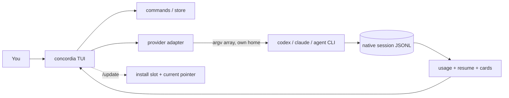

<p align="center">
  
</p>

<h1 align="center">Concordia</h1>

<p align="center">
  <b>One terminal for all your AI coding subscriptions.</b><br>
  A fast, local, Rust TUI that drives Codex, Claude and Cursor under the accounts you already pay for.
</p>

<p align="center">
  <a href="../../actions/workflows/ci.yml"></a>
  
  
  
  
</p>

> **Status: pre-release.** Codex chat works end to end for an already-logged-in home.
> Account onboarding, Claude/Cursor parity and failover are in progress.
> The honest, ranked gap list lives in [docs/e2e-status.md](docs/e2e-status.md).

## Why Concordia

You pay for more than one AI coding tool. Each has its own CLI, its own login, its own session store and its own usage limit, and switching between them means losing your place. Concordia puts them in one terminal, as a thin layer over the CLIs you already have. It does not replace them, proxy them, or touch your credentials.

- **Use several of your own subscriptions in one terminal.** Codex, Claude and Cursor side by side: no hosted service, no API keys, no extra billing.
- **Switch accounts in one command.** `/use` picks a provider and account; each account keeps an isolated home.
- **See what is used and what is left.** `/usage` shows the current account's limit windows as used and left (`/usage all` for every account), taken from each CLI's own usage view. It never sends a prompt to a model.
- **Share bounded context between providers.** Switch provider mid-task and Concordia hands the new one a bounded continuity pack instead of the whole history ([continuity](docs/continuity.md)).
- **Delegate to worker accounts.** One account is the orchestrator you type into; up to three others run as visible workers on tasks you hand them (`/delegate`). Each worker gets its own session and a bounded slice of context, nothing runs unseen, and you can stop any of them ([delegation](docs/delegation.md)).
- **Expand activity.** Click a card's gutter to expand it, or use `Ctrl+E` for searchable detail and copy. `Ctrl+O` toggles all received tool activity and reasoning.
- **Process counters.** `/stats` toggles RAM/CPU for Concordia and the provider process trees; `[ui] stats = true` enables it at startup.
- **Provider updates.** Keep updating the official CLIs normally. Concordia checks version/help capabilities and falls back when optional flags disappear; it never updates provider CLIs itself.
- **See the wait.** The prompt border and title show what the model is doing (waiting, thinking, running a tool, writing) with its own colour, animation and timer; reasoning appears as dim lines ([waiting states](docs/tui-states.md)).
- **Robust turns.** Provider output with invalid UTF-8 or multi-megabyte lines cannot truncate a reply; multi-line prompts go over stdin when the provider CLI sits behind a Windows `.cmd` shim; `Ctrl+C` kills the provider's whole process tree; a failing provider reports its exit code and stderr instead of an empty reply.
- **Safe shared state.** State writes are atomic and serialized across panes, an unreadable `store.json` is backed up rather than overwritten, and `concordia --version` and `concordia doctor` never modify anything.
- **Never guess a session.** Resume is always bound to an explicit session id. Concordia will never run `resume --last` or pick "whichever pane is focused".
- **Honest about state.** Every build carries a stamp so you can tell at a glance whether a pane is running stale code.

## What Concordia is, and is not

**It is** a thin Windows terminal app that runs the Codex, Claude Code and Cursor CLIs, unmodified, under your own logins, and adds the parts that live between them: several accounts, what is left of each one's limits, bounded context when you switch, visible delegation to other accounts, and a prompt box that behaves like a normal editor.

**It is not**
- **A model or an agent.** It has no model of its own, no agent loop and no tool runtime. Every answer, tool call and approval is the provider CLI's.
- **A replacement for the CLIs' own setup.** Skills, rules, memory, MCP servers and hooks stay with each CLI and keep working, because Concordia only points the CLI at an account folder. Concordia never reads or imports them. One consequence: an account Concordia creates starts with an empty folder, so skills you installed in your own `.claude` or `.codex` are not there until you add them.
- **A credential tool.** You sign in through each provider's own login window. Concordia never reads, stores or sends a token, key or cookie.
- **An account rotator.** Moving to another account is always your choice. Concordia will not switch for you to get around a limit.
- **Cross-platform yet.** Windows only for now.
- **Hosted or tracking.** There is no server, account or telemetry. The binary has no HTTP client; the only network access Concordia starts itself is the release download behind `/update`. The provider CLIs make their own connections, as they always do.

## Features

| | |
| --- | --- |
| Chat TUI | Streaming turns with live command and tool cards, built on `ratatui` |
| Mouse-native | Click to place the caret, drag to select, double/triple-click for word/line, wheel to scroll, right-click to copy or paste |
| Real prompt editor | Multi-line, caret and selection, word moves, cut/copy/paste, bracketed paste (pasted newlines never send) |
| Account picker | `/use` across Codex, Claude and Cursor homes |
| WezTerm launcher | `concordia wezterm` opens WezTerm running Concordia with split/tab keys (Ctrl+Shift+D/E/T); the config ships inside the binary |
| Slash palette | Type `/` for a live list of commands with descriptions; arrows and Tab to pick |
| Account connect | `/use add` creates an isolated home for a new account and opens the provider's own login; Concordia tells you when it connects |
| Usage at a glance | `/usage` shows used and left per limit window: Codex from its session data, Claude from its local `/usage`, Cursor from its usage screen. No prompt is ever sent to a model |
| Explicit resume | `/resume` lists sessions and binds by id |
| Continuity pack | Bounded context hand-off when you switch provider mid-task |
| Trust modes | `ask`, `workspace`, `full`, shown live in the status line |
| Self-update | `/update` rebuilds, swaps to an unlocked binary slot, and re-execs in the same pane |
| Cancel | `Ctrl+C` terminates the tracked provider child process, nothing else |

## Screenshots

Rendered from the real UI code with synthetic data (no provider is run). Regenerate with the command under [Contributing](#contributing).

| | |
| --- | --- |
| <br>Type `/` for a live command palette | <br>`/usage`: used and left per account |
| <br>A turn in progress: phase, live thinking, running tool card | <br>Tool cards and a markdown reply |

## Speed

Measured on 11th Gen Intel(R) Core(TM) i7-1165G7 @ 2.80GHz, Windows 11, 2026-10-15, build 2026-10-15x.

| Metric | Value |
| --- | --- |
| Release binary size | 2838 KB |
| Cold start, `concordia --version` (median of 30 runs) | 26.2 ms |
| Cold start, `concordia --version` (p95 of 30 runs) | 35.7 ms |
| `draw_ui` frame, busy transcript, 110x32 (mean of 500 frames) | 147 us |
| `draw_ui` frame, busy transcript, 110x32 (p95 of 500 frames) | 274 us |

Reproduce with `powershell -NoProfile -File scripts\metrics.ps1`; details in [docs/metrics.md](docs/metrics.md).

## Install

**Requirements:** Windows 10/11, [Rust](https://rustup.rs) with MSVC Build Tools, and at least one provider CLI (`codex`, `claude` or `agent`) already logged in.

Full guide: [docs/install.md](docs/install.md). The one-liner (placeholder until the first release):

```powershell
# irm <release-url>/install.ps1 | iex
```

From source today:

```powershell
git clone <this-repo> concordia
cd concordia
.\scripts\install-dev.ps1
```

The script builds a release binary, installs it to `%LOCALAPPDATA%\concordia\bin`, writes a `current` pointer so every launcher agrees on the active build, and prints the version.

```powershell
concordia --version
concordia doctor      # health check: install, provider CLIs + versions, accounts; exit 1 on a problem
```

Run any copy of the exe once with `install` to put it on your PATH: `.\concordia-x86_64-pc-windows-msvc.exe install`, then open a new terminal.

Prebuilt downloads (`concordia-x86_64-pc-windows-msvc.exe`, `SHA256SUMS`, `THIRD-PARTY-LICENSES.txt`) will be attached to GitHub Releases once the project is published. Verify with `Get-FileHash .\concordia-x86_64-pc-windows-msvc.exe -Algorithm SHA256` against `SHA256SUMS`.

### Updating

`/update` adapts to how you installed Concordia:

- **From source:** inside the checkout it rebuilds, installs into a free slot, and restarts the pane on the new build.
- **From a release download:** it fetches the newest release of the configured repository (`CONCORDIA_UPDATE_REPO=owner/name`), verifies the checksum, confirms the new binary runs and reports the expected version, and only then switches over. If any check fails, nothing is installed. `/update check` shows what would happen without changing anything.

Concordia only contacts the network when you run `/update`.

## Quick start

```powershell
concordia
```

1. Type `/use` and pick an account.
2. Type a prompt and press `Enter`. `Ctrl+C` cancels.
3. Type `/usage` to see remaining limits, `/resume` to continue an earlier session.

## Workflows

**You ran out of usage mid-task.** The footer shows used and left for the current account (`/usage` for the detail). Switch with `/use` and keep typing. Concordia starts a new session on the other account and puts a bounded pack of the recent conversation in front of your next prompt, headed `[concordia prior thread - bounded - N chars - tools/approvals NOT transferred]`. It is plain recent user and assistant text, capped at 6000 characters, with no summarising model and nothing copied that you did not see. The new model learns the thread from that header and text; it is not given your credentials, tool state or approvals. Switching stays manual, on purpose: Concordia never rotates accounts for you to get around a limit.

**You continue the same conversation on the same account.** Nothing is injected. Concordia resumes the explicit session id it recorded (`--resume <id>`), never `--last`.

**You want an earlier chat back.** `/resume` lists sessions and binds the one you pick by id.

**You think of the next prompt while a turn runs.** Press `Tab` to queue it; the queue shows above the prompt box and each item is sent when the turn before it finishes cleanly. `Ctrl+Up` focuses the queue while preserving your draft. Enter opens a multiline upper editor and saves it; Esc cancels the edit. `Ctrl+Down` returns to the draft after save/cancel; `Alt+Up/Down` reorders queued prompts. Cancelling, failure and restart pause the queue: `Ctrl+R` or `/queue resume` explicitly resumes it. Drafts and queues use separate recovery records for each pane and workspace; `/recover` chooses abandoned work. Sent history remains shared.

**You want help from another account.** `/workers add <account>`, then `/delegate <account> <task>`. The worker runs one visible turn with its own session and a bounded slice of context. Its result comes back as a labelled block, and `/delegate use` sends it to your main conversation when you choose ([delegation](docs/delegation.md)).

**Do the models know they are inside Concordia?** Not in general today. They see the pack header after a switch, and delegated workers get a labelled task. A short opt-in "you are running inside Concordia" note, `@chat` references that expand to a bounded pack, and a `/handoff` command are on the [roadmap](#roadmap).

## Commands

| Command | What it does |
| --- | --- |
| `/use` | Account picker (ends with `+ add account`) |
| `/use remove [account]` | Remove an account: delete what Concordia created, or just hide one of your own (your own login folders are never deleted) |
| `/use add [codex\|claude\|cursor]` | Connect a new account: isolated home under `%LOCALAPPDATA%\concordia\homes`, native login in a new window |
| `/model` | Models from on-disk caches only |
| `/usage`, `/usage all` | Limits for this account, or for every account (used and left per window) |
| `/mode` | Show or set the mode: `plan`, `ask`, `auto` (workspace) or `full` (also `Shift+Tab`) |
| `/workers`, `/workers add`, `/workers remove` | Choose which accounts can act as workers |
| `/delegate <account\|auto> <task>` | Run one task on a worker account; `/delegate stop`, `/delegate use`, `/delegate help` |
| `/resume`, `/chats` | Pick an explicit session id (never `--last`) |
| `/trust` | `plan`, `ask`, `workspace` or `full` |
| `/config` | Connection help, including manual login commands |
| `/new` | Clear the session bind |
| `/split` | Open another `concordia` in a WezTerm split |
| `/update` | Update (rebuild from source, or download the newest release), then re-exec this pane |
| `/update check` | Report whether an update is available, without installing |
| `/version` | Build stamp and paths |
| `/copy` | Copy the last assistant reply |
| `/doctor` | Quick health check (install, state, provider CLIs, accounts) |
| `/exit` | Quit |

## Keyboard and mouse

| Key / mouse | Action |
| --- | --- |
| `Enter` | Send turn |
| `Shift+Enter`, `Alt+Enter`, `Ctrl+J` | Newline without sending |
| `Tab` | Complete a slash command; while a turn runs (or prompts are queued), queue the typed prompt |
| `Shift+Tab` | Cycle the mode: plan, ask, auto-edit, full (moves the selection up while the palette is open) |
| `Alt+Up` / `Alt+Down` | Select a worker row; `Enter` opens its transcript, `Esc` closes it. In the queue panel, move the selected prompt up or down |
| Click | Place the caret (prompt); release on an underlined file reference to open it in another terminal. Alt+click previews Markdown; dragging keeps selection |
| Drag, double-click, triple-click | Select text / a word / a line (prompt or transcript) |
| `Ctrl+C` | Copy the selection; with nothing selected, cancel the running turn; when idle, press twice to exit |
| `Up` / `Down` | Walk previously sent prompts (on the first / last prompt row); with an empty box and a non-empty queue, `Up` focuses the queue panel (`Enter` edits, `Delete` removes, `Esc` returns). History is kept in `<state>\history.jsonl` (`[ui] persist_history`) |
| `Esc` | Clear a selection, or interrupt a running turn. It never quits |
| `Ctrl+Shift+C`, `/copy` | Copy the last reply when nothing is selected |
| `Ctrl+A` / `Ctrl+X` / `Ctrl+V` | Select all / cut / paste in the prompt |
| `Ctrl+O` | Expand or collapse full received tool activity and reasoning |
| `Ctrl+E` | Open searchable full activity detail; `Esc` closes and `Ctrl+C` copies |
| `Ctrl+Up` / `Ctrl+Down` | Focus queued prompts / return to the draft after save or cancel |
| `Ctrl+R` | Resume a paused queue while preserving the draft |
| `/open PATH`, `/preview PATH` | Separate terminal editor / read-only Markdown preview; see [editor configuration](docs/config.md) |
| `Ctrl+Z` | Undo in the prompt (also right after a send, which puts the sent text back) |
| `Ctrl+Shift+Z`, `Ctrl+Y` | Redo |
| Right-click | Copy the selection, or paste when there is none |
| Wheel, `PgUp` / `PgDn` | Scroll the transcript (sending a message snaps back to the latest) |
| `Shift` / `Ctrl` + arrows, `Home`, `End` | Extend selection, move by word, jump to line edge |

> **WezTerm note:** Concordia captures the mouse, so plain drags select inside Concordia. Hold `Shift` while dragging to use WezTerm's own selection instead. WezTerm intercepts `Ctrl+Shift+C`, so use `Ctrl+C`, right-click or `/copy`.

## Behaviours worth knowing

- **Continuing on the same account** resumes the session id Concordia recorded (`--resume <id>`). Nothing is added to your prompt.
- **Switching account or provider** starts a new session on the other side, with bounded recent context in front of your next prompt. Tool state, approvals and the provider's own memory are not carried over, and the pack says so in its header.
- **Limits come from three different places.** Codex's numbers come from its own session files, so they appear only after a chat and reflect the last one; a window that has reset since then shows as reset, not as still used. Claude's come from its own local `/usage`, which takes a few seconds. Cursor has no usage command, so Concordia reads Cursor's interactive usage screen in a hidden pseudo-console (in an empty temporary folder that Cursor is told to trust), about six seconds the first time. Claude and Cursor readings are cached, re-checked after every turn and whenever they are older than two minutes, and show their age once they are. When a provider gives nothing, the footer says why instead of showing a number.
- **`/usage` never sends a prompt to a model.** It runs each CLI's own usage view.
- **Streaming and thinking.** Claude and Cursor run in streaming mode, so tool and command cards appear as they happen. Reasoning is shown only if the provider emits it, as dim lines that stay in the transcript but are never sent as context.
- **Plan mode** maps to each CLI's own flag. Codex has no separate plan mode, so Plan there is the same read-only sandbox as Ask.
- **The models do not know they are inside Concordia** beyond the header on a switch pack. A short opt-in note, `@chat` references and a thread map they can look things up in are planned (see [architecture](docs/architecture.md)).
- **Unsigned and unpublished.** The release binary is not code-signed yet, so Windows SmartScreen may warn. No release has been published, and the install scripts use a placeholder owner until one is.
- **Not yet verified live:** the `/use add` login window, mouse selection inside WezTerm, and real multi-line turns through each provider. The automated tests use a fake provider by design, so they never spend your subscription.

## Safety and provider terms

- Concordia runs the **unmodified** provider CLIs under **your own logins**. It is not a proxy and does not pool or share accounts.
- It never reads, copies, stores or asks for a password, key or token. New accounts get an isolated home that Concordia creates, and login is the provider's own flow. It never writes to your existing `.codex` / `.claude` homes.
- It makes no network calls of its own, except when you run `/update`.
- What the providers' terms say, and where the lines are: [docs/provider-terms.md](docs/provider-terms.md).

## Configuration

| Variable | Purpose |
| --- | --- |
| `CONCORDIA_STATE_DIR` | Where Concordia keeps its state (default `%LOCALAPPDATA%\concordia`) |
| `CONCORDIA_CODEX_BIN`, `CONCORDIA_CLAUDE_BIN`, `CONCORDIA_AGENT_BIN` | Use a specific provider CLI instead of the one on `PATH` |
| `CONCORDIA_EXE` | The active Concordia binary (set by the installer; follows the `current` pointer) |
| `CONCORDIA_INSTALL_DIR` | Install somewhere else (portable installs); also keeps tests off your real install |
| `CONCORDIA_UPDATE_REPO` | `owner/name` of the GitHub repository `/update` downloads releases from |
| `CONCORDIA_UPDATE_PRERELEASE` | `1` to include pre-releases (0.x installs include them automatically) |
| `CONCORDIA_UPDATE_API` | Alternate API base (a mirror); plain `http` is accepted only for loopback |
| `CONCORDIA_CONFIG` | Path of `config.toml` (default `<state>\config.toml`) |

Optional defaults live in `config.toml`, and your own slash commands in `commands\*.md`, both under the
state directory: see [docs/config.md](docs/config.md).

## How it works



- **Provider adapters** spawn the official CLI with a safe argument array and an isolated per-account home, then parse its structured output into cards.
- **Native state stays native.** Usage, sessions and models are read from the files the CLIs already write.
- **One owner for recovery.** A turn has exactly one tracked child process; cancellation and recovery never replay uncertain tool actions.
- **`concordia` is always the newest build.** A Windows exe is locked while it runs, so installing moves the old `concordia.exe` aside and puts the new one in its place; panes still running the old build keep working, and every new launch gets the new one. `%LOCALAPPDATA%\concordia\bin\current` names the active build for the WezTerm config and the npm shim.

More detail: [continuity](docs/continuity.md), [UI architecture](docs/ui-architecture.md), [provider capabilities](docs/capabilities.md), [provider terms](docs/provider-terms.md), [changelog](CHANGELOG.md).

## Project stats

Measured from this checkout (`cargo test -p concordia --tests --locked`, `cargo tree`), not estimated.

| Metric | Value |
| --- | --- |
| Rust source | 41 files under `crates/concordia/src`, ~21.0k lines |
| Tests | 342 passing, 0 failing (unit, TUI end-to-end with simulated mouse/keys, a fake provider driving the real turn runner, continuity, control-plane) |
| Release binary | 2838 KB |
| Dependencies | 11 direct, 76 crates in the normal dependency tree (all permissive except one unmodified MPL-2.0 crate; see `NOTICE`) |
| Provider adapters | Codex, Claude, Cursor |

## Roadmap

| Area | State |
| --- | --- |
| Launch / versioning (`current` pointer, build stamp, `/update`) | Done |
| Codex chat, cards, cancel, usage, resume | Working |
| Tab complete, paste, mouse selection, copy, scroll, caret editing | Implemented, awaiting live-pane verification |
| `/use add`: create and connect an account from inside Concordia | Implemented, awaiting live login check |
| Prompt history (up arrow), double-tap `Ctrl+C` exit | Done |
| Claude / Cursor session-id bind after turns | Done |
| Orchestrator and worker accounts (`/delegate`) | Implemented, awaiting live verification |
| Opt-in "inside Concordia" note, `@chat` references, `/handoff` | Planned |
| Exhaustion to another account with explicit session bind | Planned |
| Linux / macOS | Not claimed |
| Autonomous multi-agent crews (no user approval) | Out of scope |

What stands between this and a public release is tracked in [docs/release-blockers.md](docs/release-blockers.md).

## Contributing

```powershell
cargo test -p concordia --tests
powershell -NoProfile -File .\scripts\smoke-e2e-everyday.ps1    # installs your build, then checks help, tests, usage read
powershell -NoProfile -File .\scripts\verify-oss-gates.ps1
cargo test -p concordia --lib screenshots -- --ignored            # regenerate docs/img/*.svg after a UI change
powershell -NoProfile -File .\scripts\metrics.ps1                # regenerate docs/metrics.md
```

Rules that keep this honest:

- Bump `BUILD_STAMP` in `crates/concordia/src/version.rs` on every user-facing change, so "still old" is falsifiable.
- `smoke-e2e-everyday.ps1` must exit 0 after every user-facing change.
- Live provider tests spend real subscription usage and need an explicit budget.
- Never overwrite a user's existing `.codex` / `.codex-2`; Concordia-owned homes live under Concordia's own state directory.

See [CONTRIBUTING.md](CONTRIBUTING.md), [SECURITY.md](SECURITY.md), [UI architecture](docs/ui-architecture.md), [provider capabilities](docs/capabilities.md) and the [changelog](CHANGELOG.md).

## FAQ

**Does Concordia send my code or prompts anywhere?** No. It runs the provider CLI locally under your login. Concordia itself makes no network calls.

**Does it read my credentials?** No. Credentials stay in each provider's own home; Concordia never reads secret files.

**Does `/usage` cost tokens?** No. It never sends a prompt to a model: Codex limits come from session data on disk, Claude answers its own `/usage` locally, and Cursor's usage screen is read from the CLI.

**Why not `resume --last`?** It resumes whatever was most recent, which is often the wrong conversation. Concordia only resumes an id you chose.

**My pane shows an old version.** The header stamp must match `concordia --version`. If not, that pane is stale: close it and open a new tab.

## License

[MIT](LICENSE). See [NOTICE](NOTICE) for third-party attributions.
