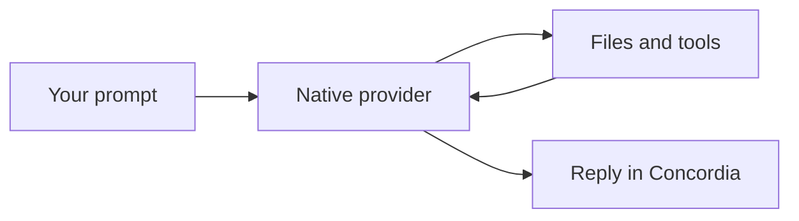

# Images and diagrams in Concordia

Build: `2026-11-03u`. Supported provider adapters: Codex, Claude Code and Cursor CLI.

## Attach an image

Use Ctrl+V when the terminal passes that key to Concordia, `/attach` to choose a file, or
`/attach "path/to/screenshot.png"`. Relative paths resolve from Concordia's cwd; quoted absolute
paths work. `/attach clear` removes draft attachments. A visible image chip shows the name and
size. The first image previews automatically above the editable composer; click its thumbnail or
any image chip to enlarge it, or X to remove it. Paste and file-picker helpers run
away from the input loop and request no console window.

PNG, JPEG and WebP are accepted, up to four distinct images of 4 MiB each per message. Clipboard
bitmaps are saved as PNG. Image-only submission uses a short request to describe the image.
Sending and queueing wait for capture to finish. Selecting a file explicitly attaches pixels;
merely opening an image or mentioning a path does not silently attach it.

A selected image is copied into app-owned, content-addressed storage. Changing the original file
after queueing does not change the attached snapshot. Byte hashes are checked before dispatch.
Drafts, queue records, inline queue edits and unfinished-request checkpoints retain attachment
references. Reordering/sending a queue item keeps its images. Missing or modified snapshots cause
an explicit failure rather than silent omission. Saved snapshots remain local for recovery.

Image input is native, not OCR or vector embeddings:

| Provider | Transport |
| --- | --- |
| Codex | `--image` file arguments; prompt still uses the normal safe argv/stdin path |
| Claude Code | `--input-format stream-json` with text and base64 image content on stdin |
| Cursor | `agent acp`, image prompt capability check, exact session new/load, then `session/prompt` image content |

Images are not encoded into model prompt text or command-line strings. A selected model must
support vision. Native CLI/model limits still apply. Custom batch launchers are rejected for
image argv transport instead of exposing payloads to shell reparsing. Cursor image turns handle
native permission and choice requests with their original RPC request ids; the ordinary Cursor
text adapter still uses print mode. This does not establish complete native interaction parity
for every provider or background worker.

Image chips and image file links open an inline raster preview. Esc returns to the unchanged
draft; E explicitly opens the system viewer. The preview uses ordinary true-color cells with
half-block glyphs and normal frame clipping/redraw, without a terminal image escape protocol.
No-color mode previews the pixels with luminance characters. This is a terminal-resolution preview, not pixel-perfect
rendering or evidence of physical-host image protocol support.
GIF links retain the existing system-viewer action; the inline decoder does not enable GIF.

One background decoder handles PNG/JPEG/WebP files up to 4 MiB, 4096 pixels per edge,
16 megapixels and 64 MiB decoded output. Decoder allocation limits are 96 MiB; upstream defines
that allocation limit as non-strict, while edge limits are strict. Eight content-hash thumbnails
at at most 256×256 RGBA pixels retain at most 2 MiB. Composer previews verify the snapshot hash.
Each open hashes bounded file bytes; unchanged cached images skip decoding. Closing cancels
publication of the result; the bounded decode can finish off-thread and another job cannot start
until it exits. Histories are never predecoded. Selected historical image links use the same action.

## Attach a text document

Use `/attach notes.md`, `/attach "path/to/document.txt"` or the file chooser for UTF-8
`.txt`, `.md`, `.markdown` and `.json` files. Four attachments total may be mixed with images;
documents share a 64 KiB byte budget. Binary files, sensitive paths, linked files, NUL bytes and
invalid UTF-8 are refused. Selecting a document opens its snapshot in a read-only internal preview.
Click a document chip to inspect that snapshot or X to remove it without changing the message.

The versioned envelope records ordered metadata and content hashes, without embedding document
bytes in draft/queue records. Existing image-only envelopes remain compatible. Dispatch verifies
the snapshot and includes its exact UTF-8 text as labelled user document data in the native text
prompt. Images retain their native transports. Missing/changed snapshots or unknown envelope
versions/kinds pause explicitly before provider execution. These labels are provenance, not a
guarantee that a model will ignore instructions contained in a document.

Pasted file paths, including file drops represented by the host as quoted path text, remain
ordinary editable message text. Eligible absolute image/document path lists offer **F9 attach
pasted files**; nothing is read or imported until that action. Attachment import preserves the
pasted text and is bound to the same conversation, workspace and draft revision. Later typing or
switching conversations invalidates a pending import. Up to four paths and 16 KiB of pasted path
text are accepted. No shell expansion, host configuration change or dropped-file execution occurs.

PDF attachments are now a bounded native Claude candidate. The version-matched [TypeScript SDK
`UserMessage` input union](https://code.claude.com/docs/en/agent-sdk/typescript#sdkusermessage)
places image/document blocks in `message.content`; this is user input, not the older output
`ContentBlock` union. Concordia dispatches the ordered document block through Claude 2.1.317
standard stdin and `ClaudeStdio` only, after the capability/version gate. Each PDF is capped at
8 MiB, all PDFs together at 16 MiB, and the message at four attachments. Snapshots retain the
SHA-256 descriptor and refuse sensitive or linked paths, changed identity/hash, missing `%PDF-`
signature, and encrypted files marked with `/Encrypt`. Codex and Cursor currently reject PDF
dispatch before child spawn; no OCR, rasterization or Read-tool conversion is substituted.

The PDF block schema is `{"type":"document","source":{"type":"base64","media_type":"application/pdf","data":"<base64>"}}`; descriptor SHA-256 remains local integrity metadata and is not injected into native content.

Attach through the existing picker/F9 path flow. The PDF chip opens the immutable snapshot in the
system viewer as an explicit file action; it does not rasterize or OCR the document. Drafts,
queues and checkpoints retain descriptor metadata and the original envelope. Fake-process tests
cover schema/order, Standard Claude and ClaudeStdio payloads, unsupported providers and tamper
rejection. Installed/live provider parity, physical viewer behavior and real PDF quality remain
unqualified pending focused checks.

## Mermaid

A complete fenced Mermaid block renders inside chat and formatted Markdown files:

The source stays in the recorded response/file. Rendering uses pinned `mermansi` 0.1.6 in-process,
without a browser, Node process, remote renderer or model request. Up to two background jobs run
at once, with 32 cached source/width entries. Input is limited to 8 KiB, 128 source lines and 256
semicolons; presentation is capped at 200 columns, 128 rows and 128 KiB output. Partial streamed
fences wait for completion. Invalid, unsupported or oversized diagrams retain readable source
and an explanation. Terminal output is sanitized before display.

## Evidence and limits

Synthetic process fixtures verify pixel payloads for all three adapters, exact Cursor session
binding, capability rejection, quota failure and permission responses. A terminal journey drives
Mermaid rendering, attachment chips, submission and native Cursor permission selection through
all three fake providers. Draft recovery and queue editing have separate renderer/state tests.
The installed Cursor CLI's initialize-only probe advertised image and exact-session load support.
No real model/image-analysis turn was run; authentication and vision quality are not certified by
these fixtures. Final installed-build results belong in [E2E status](e2e-status.md).

Primary interfaces: [Codex image flags](https://learn.chatgpt.com/docs/cli/reference),
[Claude streaming images](https://code.claude.com/docs/en/agent-sdk/streaming-vs-single-mode),
[Cursor ACP](https://prod.cursor.com/docs/cli/acp),
[ACP image content](https://agentclientprotocol.com/protocol/v1/content).

Long histories keep completed diagram rows without re-rendering them after unrelated changes.
Up to 16 diagrams per message render; additional diagrams retain source.

## Native PDF follow-up

The first Python SDK audit examined an output content union; that did not settle accepted user
input. The official [TypeScript SDK streamed user-message contract](https://code.claude.com/docs/en/agent-sdk/typescript#sdkusermessage)
explicitly places images and documents in `message.content` and identifies native support from
CLI 2.1.277. Installed 2.1.317 exceeds that threshold. This supplies the missing native wire
contract. The current candidate adds bounded snapshots and dispatch; schema/fixture support
remains distinct from installed and live parity, which still requires focused qualification.
