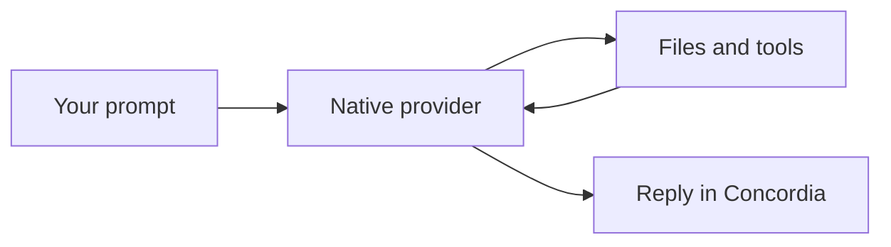

# Images and diagrams in Concordia

Build: `2026-11-04j`. Supported provider adapters: Codex, Claude Code and Cursor CLI.

## Attach an image

The default Windows window owns keyboard and drag/drop input. Use Ctrl+V or Ctrl+Shift+V to
paste an image, drop local image files into the window, F9 to paste a clipboard image or
choose a file, `/attach` to choose a file, or
`/attach "path/to/screenshot.png"`. Relative paths resolve from Concordia's cwd; quoted absolute
paths work. `/attach clear` removes draft attachments. A visible image chip shows the name and
size. Images, text documents and PDFs share six-row attachment cards above the composer.
Cards sit horizontally when space allows and wrap into balanced rows; short windows use
compact overflow rows so every attachment retains open/remove controls. Each X sits above
its content. Click an image to enlarge it, a document to inspect it, or X to remove it.
Paste and file-picker helpers run
away from the input loop and request no console window.
Typing while an import finishes keeps both the evolving message and the attachment. Replacing
the draft or switching conversations prevents an old import from attaching to the new draft.
Copying image files in Explorer and pasting into Concordia also imports their snapshots; the
Windows clipboard file-drop format is recognized in addition to screenshot bitmaps.
Registered PNG clipboard streams are accepted even when the clipboard has no bitmap/DIB format.
An explicit empty bracketed-paste event checks for an image; unbracketed file-drop character
bursts recognize the whole local path before inserting ordinary text.

Explicit `--terminal` mode still depends on the host forwarding paste input. Windows Terminal
binds Ctrl+V and Ctrl+Shift+V to its own paste action, which can consume bitmap-only paste without
an input event. Normal Windows launches use Concordia's own window instead of asking users to
change global bindings. No host settings, global keyboard listener or hook is installed.

PNG, JPEG and WebP are accepted, up to four distinct images of 4 MiB each per message. Clipboard
bitmaps are saved as PNG. Image-only submission uses a short request to describe the image.
Sending and queueing wait for capture to finish. Selecting a file explicitly attaches pixels;
merely opening an image or mentioning a path does not silently attach it.

On Windows, verified stock npm launchers for Codex and Claude run their declared JavaScript
entrypoints through native Node when the direct native bridge cannot be verified. This keeps
image paths and prompts out of shell parsing and preserves updated package behavior. Custom
batch launchers remain unsupported for native image inputs. A rejected input before the provider
starts releases its workspace reservation; older uncertain reservations still require inspection
and `/scope stopped` acknowledgment because their records lack reliable startup evidence.

A selected image is copied into app-owned, content-addressed storage. Changing the original file
after queueing does not change the attached snapshot. Byte hashes are checked before dispatch.
Drafts, queue records, inline queue edits and unfinished-request checkpoints retain attachment
references. Reordering/sending a queue item keeps its images. Missing or modified snapshots cause
an explicit failure rather than silent omission. Saved snapshots remain local for recovery.

Image input is native, not OCR or vector embeddings:

| Provider | Transport |
| --- | --- |
| Codex | `--image` file arguments; prompt still uses the normal safe argv/stdin path |
| Claude Code | `--input-format stream-json` with text and base64 image content on stdin |
| Cursor | `agent acp`, image prompt capability check, exact session new/load, then `session/prompt` image content |

Images are not encoded into model prompt text or command-line strings. A selected model must
support vision. Native CLI/model limits still apply. Custom batch launchers are rejected for
image argv transport instead of exposing payloads to shell reparsing. Cursor image turns handle
native permission and choice requests with their original RPC request ids; the ordinary Cursor
text adapter still uses print mode. This does not establish complete native interaction parity
for every provider or background worker.

Image chips and image file links open an enlarged image preview. Esc returns to the unchanged
draft; E explicitly opens the system viewer. The default Windows window draws original decoded
pixels directly, fitting the available area with smooth scaling and no upscaling. The compact
composer thumbnails stay small; their cache is limited to 512 pixels per edge. The enlarged
viewer loads original resolution and retains detail beyond the old 256-pixel
thumbnail. Neither preview changes the original attachment bytes sent to the provider.
Explicit terminal mode uses true-color half-block cells; no-color mode uses luminance characters.
Those terminal previews have character-cell resolution. Native pixels need no terminal image protocol.
GIF links retain the existing system-viewer action; the inline decoder does not enable GIF.

One background decoder handles PNG/JPEG/WebP files up to 4 MiB, 4096 pixels per edge,
16 megapixels and 64 MiB decoded output. Decoder allocation limits are 96 MiB; upstream defines
that allocation limit as non-strict, while edge limits are strict. Up to eight content-hash entries
cache decoded display pixels plus 256×256 terminal thumbnails; composer pixel buffers are capped
at 512 per edge, while the enlarged viewer reloads original resolution. Entries are evicted above
64 MiB, retaining one current entry. The native renderer caches the active converted bitmaps:
at most four bounded composer previews or one full-resolution viewer bitmap of at most 64 MiB.
Composer previews verify the snapshot hash.
Each open hashes bounded file bytes; unchanged cached images skip decoding. Closing cancels
publication of the result; the bounded decode can finish off-thread and another job cannot start
until it exits. Histories are never predecoded. Selected historical image links use the same action.

## Attach a text document

Use `/attach notes.md`, `/attach "path/to/document.txt"` or the file chooser for UTF-8
`.txt`, `.md`, `.markdown` and `.json` files. Four attachments total may be mixed with images;
documents share a 64 KiB byte budget. Binary files, sensitive paths, linked files, NUL bytes and
invalid UTF-8 are refused. Selecting a document opens its snapshot in a read-only internal preview.
Click a document chip to inspect that snapshot or X to remove it without changing the message.

The versioned envelope records ordered metadata and content hashes, without embedding document
bytes in draft/queue records. Existing image-only envelopes remain compatible. Dispatch verifies
the snapshot and includes its exact UTF-8 text as labelled user document data in the native text
prompt. Images retain their native transports. Missing/changed snapshots or unknown envelope
versions/kinds pause explicitly before provider execution. These labels are provenance, not a
guarantee that a model will ignore instructions contained in a document.

Standalone pasted image paths, including file drops represented by the host as quoted path text,
attach and preview automatically. Pasted paths remain editable message text. Eligible absolute
document/PDF or mixed path lists offer **F9 attach pasted files** before importing. Merely mentioning
an image path inside prose does not attach it. Attachment import preserves the
pasted text. Accepting a pending file offer checks the original conversation, workspace and
draft revision. Once accepted, typing can continue during import; replacing the draft or switching
conversations cancels it. Up to four paths and 16 KiB of pasted path
text are accepted. No shell expansion, host configuration change or dropped-file execution occurs.

PDF attachments are now integrated in the installed 2026-11-04b candidate. The version-matched [TypeScript SDK
`UserMessage` input union](https://code.claude.com/docs/en/agent-sdk/typescript#sdkusermessage)
places image/document blocks in `message.content`; this is user input, not the older output
`ContentBlock` union. The historical z receipt dispatched the ordered document block through
Claude 2.1.317 standard stdin and `ClaudeStdio`; installed 2026-11-04b uses 2.1.318 after the
capability/version gate. Each PDF is capped at
8 MiB, all PDFs together at 16 MiB, and the message at four attachments. Snapshots retain the
SHA-256 descriptor and refuse sensitive or linked paths, changed identity/hash, missing `%PDF-`
signature, and encrypted files marked with `/Encrypt`. Codex and Cursor currently reject PDF
dispatch before child spawn; no OCR, rasterization or Read-tool conversion is substituted.

The PDF block schema is `{"type":"document","source":{"type":"base64","media_type":"application/pdf","data":"<base64>"}}`; descriptor SHA-256 remains local integrity metadata and is not injected into native content.

Attach through the existing picker/F9 path flow. The PDF chip opens the immutable snapshot in the
system viewer as an explicit file action; it does not rasterize or OCR the document. Drafts,
queues and checkpoints retain descriptor metadata and the original envelope. Fake-process tests
cover schema/order, Standard Claude and ClaudeStdio payloads, unsupported providers and tamper
rejection in the historical z receipt; the d322/22b4da5 process checks now cover the integrated
2.1.318 path. Live provider processing, physical clipboard/viewer behavior and real PDF quality remain unqualified. Codex/Cursor PDF rejection is
an explicit provider limit, not an unfinished transport.

## Mermaid

A complete fenced Mermaid block renders inside chat and formatted Markdown files:

The source stays in the recorded response/file. Rendering uses pinned `mermansi` 0.1.6 in-process,
without a browser, Node process, remote renderer or model request. Up to two background jobs run
at once, with 32 cached source/width entries. Input is limited to 8 KiB, 128 source lines and 256
semicolons; presentation is capped at 200 columns, 128 rows and 128 KiB output. Partial streamed
fences wait for completion. Invalid, unsupported or oversized diagrams retain readable source
and an explanation. Terminal output is sanitized before display.

## Evidence and limits

Synthetic process fixtures verify pixel payloads for all three adapters, exact Cursor session
binding, capability rejection, quota failure and permission responses. A terminal journey drives
Mermaid rendering, attachment chips, submission and native Cursor permission selection through
all three fake providers. Draft recovery and queue editing have separate renderer/state tests.
The installed Cursor CLI's initialize-only probe advertised image and exact-session load support.
No real model/image-analysis turn was run; authentication and vision quality are not certified by
these fixtures. Final installed-build results belong in [E2E status](e2e-status.md).

Primary interfaces: [Codex image flags](https://learn.chatgpt.com/docs/cli/reference),
[Claude streaming images](https://code.claude.com/docs/en/agent-sdk/streaming-vs-single-mode),
[Cursor ACP](https://prod.cursor.com/docs/cli/acp),
[ACP image content](https://agentclientprotocol.com/protocol/v1/content).

Long histories keep completed diagram rows without re-rendering them after unrelated changes.
Up to 16 diagrams per message render; additional diagrams retain source.

## Native PDF follow-up

The first Python SDK audit examined an output content union; that did not settle accepted user
input. The official [TypeScript SDK streamed user-message contract](https://code.claude.com/docs/en/agent-sdk/typescript#sdkusermessage)
explicitly places images and documents in `message.content` and identifies native support from
CLI 2.1.277. Installed 2.1.318 exceeds that threshold. This supplies the native wire contract;
the historical z receipt contains the initial bounded snapshot/dispatch evidence. Installed
qualification is distinct from live provider parity and physical-host behavior.
