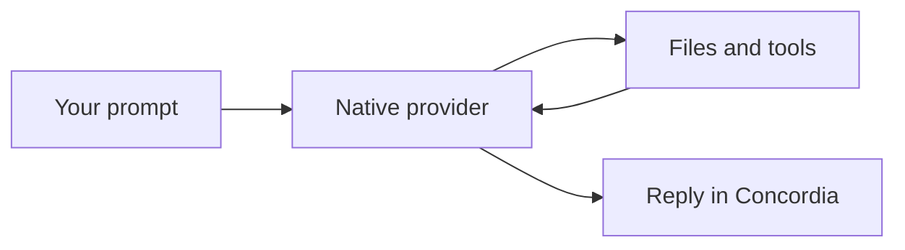

# Images and diagrams in Concordia

Build: `2026-11-01f`. Supported provider adapters: Codex, Claude Code and Cursor CLI.

## Attach an image

Use Ctrl+V when the terminal passes that key to Concordia, `/attach` to choose a file, or
`/attach "path/to/screenshot.png"`. Relative paths resolve from Concordia's cwd; quoted absolute
paths work. `/attach clear` removes draft attachments. A visible image chip shows the name and
size: click it for the system image viewer, or X to remove it. Paste and file-picker helpers run
away from the input loop and request no console window.

PNG, JPEG and WebP are accepted, up to four distinct images of 4 MiB each per message. Clipboard
bitmaps are saved as PNG. Image-only submission uses a short request to describe the image.
Sending and queueing wait for capture to finish. Selecting a file explicitly attaches pixels;
merely opening an image or mentioning a path does not silently attach it.

A selected image is copied into app-owned, content-addressed storage. Changing the original file
after queueing does not change the attached snapshot. Byte hashes are checked before dispatch.
Drafts, queue records, inline queue edits and unfinished-request checkpoints retain attachment
references. Reordering/sending a queue item keeps its images. Missing or modified snapshots cause
an explicit failure rather than silent omission. Saved snapshots remain local for recovery.

Image input is native, not OCR or vector embeddings:

| Provider | Transport |
| --- | --- |
| Codex | `--image` file arguments; prompt still uses the normal safe argv/stdin path |
| Claude Code | `--input-format stream-json` with text and base64 image content on stdin |
| Cursor | `agent acp`, image prompt capability check, exact session new/load, then `session/prompt` image content |

Images are not encoded into model prompt text or command-line strings. A selected model must
support vision. Native CLI/model limits still apply. Custom batch launchers are rejected for
image argv transport instead of exposing payloads to shell reparsing. Cursor image turns handle
native permission and choice requests with their original RPC request ids; the ordinary Cursor
text adapter still uses print mode. This does not establish complete native interaction parity
for every provider or background worker.

The preview chip opens a viewer; an inline raster thumbnail is not implemented. File drag/drop,
generic document attachments and generated-artifact cards remain separate work.

## Mermaid

A complete fenced Mermaid block renders inside chat and formatted Markdown files:

The source stays in the recorded response/file. Rendering uses pinned `mermansi` 0.1.6 in-process,
without a browser, Node process, remote renderer or model request. Up to two background jobs run
at once, with 32 cached source/width entries. Input is limited to 8 KiB, 128 source lines and 256
semicolons; presentation is capped at 200 columns, 128 rows and 128 KiB output. Partial streamed
fences wait for completion. Invalid, unsupported or oversized diagrams retain readable source
and an explanation. Terminal output is sanitized before display.

## Evidence and limits

Synthetic process fixtures verify pixel payloads for all three adapters, exact Cursor session
binding, capability rejection, quota failure and permission responses. A terminal journey drives
Mermaid rendering, attachment chips, submission and native Cursor permission selection through
all three fake providers. Draft recovery and queue editing have separate renderer/state tests.
The installed Cursor CLI's initialize-only probe advertised image and exact-session load support.
No real model/image-analysis turn was run; authentication and vision quality are not certified by
these fixtures. Final installed-build results belong in [E2E status](e2e-status.md).

Primary interfaces: [Codex image flags](https://learn.chatgpt.com/docs/cli/reference),
[Claude streaming images](https://code.claude.com/docs/en/agent-sdk/streaming-vs-single-mode),
[Cursor ACP](https://prod.cursor.com/docs/cli/acp),
[ACP image content](https://agentclientprotocol.com/protocol/v1/content).

Long histories keep completed diagram rows without re-rendering them after unrelated changes.
Up to 16 diagrams per message render; additional diagrams retain source.
